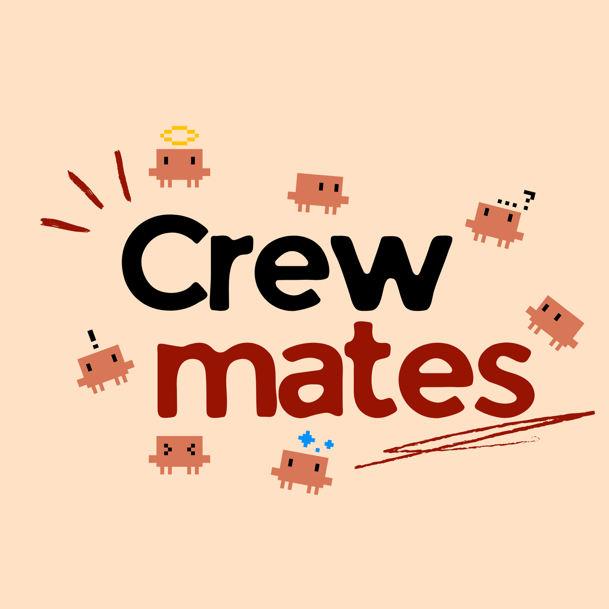
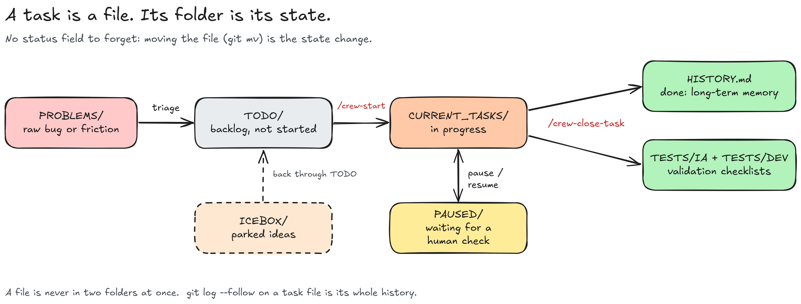
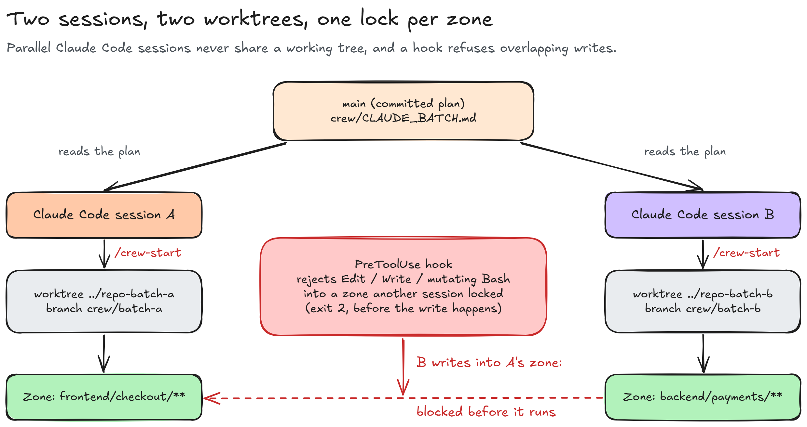
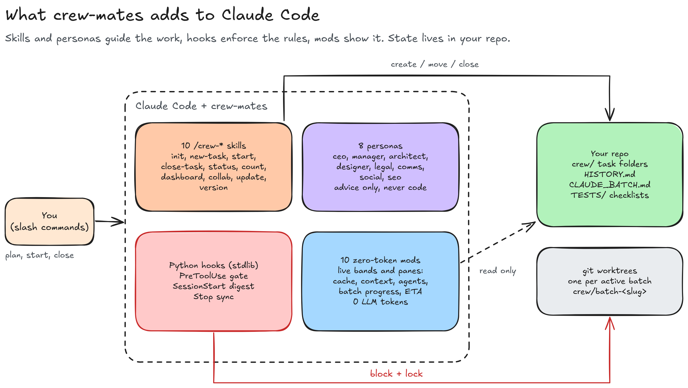

<div align="center">



# crew-mates

**Run several Claude Code sessions on one repo without them stepping on each other.**

Tasks live as Markdown files, every new session knows what is in progress, and a hook refuses writes that would collide. Eight specialist agents (CEO, architect, designer, legal…) are on call, and you can run them in parallel.

[](./LICENSE)
[](./CHANGELOG.md)
[](https://github.com/Nakken13/claude-crew/actions/workflows/ci.yml)
[](#3-what-is-in-the-box)
[](#-zero-token-mods)
[](https://github.com/anthropics/claude-code)

**[Quick start](#-quick-start)** · **[How it works](#-how-it-works)** · **[Specialist agents](#-a-crew-of-specialists)** · **[Commands](#-commands)** · **[Zero-Token Mods](#-zero-token-mods)** · **[Team mode](#-optional-several-devs-on-one-repo)** · **[Troubleshooting](#-troubleshooting)** · **[FAQ](#-faq)**

</div>

---

crew-mates is a plugin for [Claude Code](https://github.com/anthropics/claude-code). It gives your project a small, plain-text task system (a `crew/` folder of Markdown files) and the guard rails you need once you run more than one Claude Code session at a time.

- **A crew of 8 specialist agents** you can consult in parallel, plus parallel sessions that work in separate git worktrees.
- **No server, no database, no account.** Tasks are files you can `diff` and review in a pull request.
- **Install in one command, working in five minutes.**
- **Free and MIT licensed.**

<br>

## 🧩 Why

| Problem | What crew-mates does about it |
|---|---|
| 🧠 **Session amnesia.** Every new Claude Code session starts blind: what is done, what is half done, why a decision was made. | Tasks and decisions live in `crew/`. A hook injects a short digest at session start, so Claude already knows what is going on. |
| 💥 **Silent collisions.** Two sessions on the same repo will happily edit the same file at the same time. | Each batch of work gets its own git worktree, and a hook refuses a write into a zone another session has locked. |
| 🎯 **One generalist for every decision.** A product call, a legal doubt and a UX choice need different expertise. | 8 specialist agents, each with its own role and answer format, that Claude can consult in parallel. |
| 🕶️ **Flying blind.** You do not see your prompt cache about to expire, your context filling up, or how far a batch is. | 10 zero-token mods draw live status bands and side panes right in the Claude Code UI, without spending an LLM token. |

<br>

## 🎭 A crew of specialists

crew-mates ships **8 specialist agents** (Claude Code subagents, called *personas* elsewhere in the docs). Each has its own role, its own tools and its own answer format, so a product call, a legal doubt and a UX choice get an expert's framing instead of a generalist guess. Claude calls them when a decision has at least two real options in their domain, or when you ask for one by name.

| Agent | Ask it when | You get |
|---|---|---|
| `ceo` | Prioritising, cutting scope, "is this worth building?" | A recommendation framed in ROI and risk. |
| `manager` | A request must be broken into trackable work. | Task files and batches (writes only under `crew/`). |
| `architect` | Choosing a library or pattern, refactor now or later. | The trade-offs and a pick. |
| `designer` | A UX decision with real ambiguity: flows, onboarding, specs. | Concrete specs and a critique. |
| `legal` | A feature changes legal exposure: personal data, payments, minors, AI, licences. | Go, go-with-conditions or no-go, and when a real lawyer is needed. This is risk framing, not legal advice. |
| `comms` | Landing copy, emails, posts, brand voice. | Ready-to-use copy. |
| `social` | Organic social distribution. | Platform, format, cadence and a test plan. |
| `seo` | Search, store or AI-answer visibility. | Keywords, indexability, listing and a test plan with thresholds. |

Most agents are read-only advisers. `manager` writes task files under `crew/` and `comms` writes copy; none of them implements your feature.

### Run them in parallel

They are regular Claude Code subagents, so Claude can consult several at the same time and keep working while they answer. For example:

```text
Ask architect, legal and designer in parallel: should we add paid plans with Stripe this month? Then ask ceo to arbitrate.
```

Watch them work with `/crew-agents` (or the Agent Flow band): a live tree of which agent is running, with which tools and for how long.

Two kinds of parallelism, and you can use both at once:

| | Parallel **agents** | Parallel **sessions** |
|---|---|---|
| What runs | Several specialists answering one question | Several Claude Code sessions, one per batch |
| Good for | Decisions: priorities, design, legal, copy | Writing code on separate tasks |
| Isolation | They only advise | One git worktree per batch, and a hook that blocks overlapping writes |

<br>

## 👥 Who it's for

| Use it if | Skip it if |
|---|---|
| You run **more than one Claude Code session** on the same repo, one per workstream. | You work alone with **one session on a small script**: this is overhead you do not need yet. |
| You want tasks, decisions and test checklists to live in the repo as files you can **diff and review**. | You want a **hosted task board** with a UI: crew-mates is local-first and files-only. |
| You want a new session to **start knowing what is in progress**, without pasting context. | You never use git: worktrees and claims need it. |

<br>

## 🚀 Quick start

**1. Install the plugin** (in Claude Code):

```text
/plugin marketplace add Nakken13/claude-crew
/plugin install crew-mates@crew-mates
```

Restart Claude Code if the `/crew-*` commands do not appear.

**2. Set up your project** (once per project, from the project folder):

```text
/crew-init
```

It creates the `crew/` folder, detects your stack, fills every `<placeholder>` with real repo info and fails loudly until none is left.

**3. Plan and start your first tasks:**

```text
/crew-new-task Two tasks. 1) Show the cart items as a numbered list in frontend/checkout/cart.html. 2) Retry failed card charges with backoff in backend/payments/retry.py. Don't start them.
```

Commit the plan (`git add -A && git commit -m "Plan the two tasks"`), then run `/crew-start` in two terminals. Each session takes a different batch and works in its own worktree.

> [!TIP]
> Prefer not to type the install commands? Paste this into Claude Code: *"Install the crew-mates plugin (marketplace add Nakken13/claude-crew, then install crew-mates@crew-mates), then run /crew-init here."*

<details>
<summary><b>Other ways to install, and what the two names mean</b></summary>

<br>

**Manual clone ("Option C", no plugin system).** The marketplace install above is Option A and the paste-a-prompt tip is Option B. Skills, agents and Python hooks are copied straight into the project. The 10 in-process mods need the plugin (above).

```bash
git clone https://github.com/Nakken13/claude-crew.git
cp -r claude-crew/{CLAUDE.md,AGENTS.md,PRODUCT.md,CONTRIBUTING.md,SECURITY.md,crew,.claude} your-project/
```

Open `your-project` in Claude Code and run `/crew-init`.

**Try a local clone without installing:**

```bash
claude --plugin-dir /path/to/claude-crew     # one-off session, no install
```

**Why `crew-mates@crew-mates`?** The first is the plugin, the second the marketplace that serves it (`name` in `.claude-plugin/marketplace.json`). A plugin can only be installed through a marketplace.

</details>

### 👀 See it run

Two Claude Code sessions in the same repo. Session A plans two tasks and starts one batch; session B starts the other batch, in a different zone.

<!-- TODO: add the new recording as media/demo-flow.png, then uncomment:
<p align="center"></p>
-->

| # | You do | What happens |
|---|---|---|
| 1 | `/crew-init` | `crew/` is created, your stack is detected, placeholders are filled. |
| 2 | `/crew-new-task …` | The `manager` persona writes one task file per item, with `- [ ]` actions, and files each one in a batch with its **zone** (`crew/CLAUDE_BATCH.md`). |
| 3 | `git commit` | The plan is committed, so worktrees (created from `main`) contain it. |
| 4 | `/crew-start` (terminal 1) | Picks a free batch, opens `../repo-batch-a` on branch `crew/batch-a`, locks its zone. |
| 5 | `/crew-start` (terminal 2) | Picks the other batch, opens a second worktree. The two sessions never share a working tree. |
| 6 | *(a session writes into the other's zone)* | The write is refused before it runs (`exit 2`). |
| 7 | `/crew-close-task` | Checks the boxes, reviews the diff, logs the work in `HISTORY.md`, writes the test checklists. |

<br>

## ⚙️ How it works

### 1. A task is a file, its folder is its state

<p align="center"></p>

There is no status field to forget to update: moving the file (`git mv`) *is* the state change. A file is never in two folders at once, and `git log --follow` on a task file is its whole history.

### 2. Batching keeps parallel sessions apart

<p align="center"></p>

Plenty of scaffolds give you a prompt template and a folder layout. crew-mates tracks *which files each task touches* (its **zone**), groups tasks that share a zone into the same batch, and **prevents** a collision when a batch overlaps an active one it does not belong to. Two layers:

- **Layer 1 – physical isolation.** Each active batch runs in its own `git worktree` (`../<repo>-batch-<slug>/`) on its own branch (`crew/batch-<slug>`). Two sessions on two batches never point at the same working tree.
- **Layer 2 – a blocking gate.** A `PreToolUse` hook intercepts every `Edit`/`Write`/`MultiEdit` and every mutating `Bash` command (`rm`, `mv`, `cp`, redirections, `git mv`) and **rejects it (`exit 2`) before it runs** if the path falls under a `Zone:` locked by a *different* session. The lock is registered the moment a task moves `TODO → CURRENT_TASKS`, under a mutex with an atomic replace, so two sessions racing for the same batch cannot both win.

```text
🟢 Batch A — Zone: frontend/checkout/**   [worktree ../repo-batch-a/, branch crew/batch-a]
🟢 Batch B — Zone: backend/payments/**    [worktree ../repo-batch-b/, branch crew/batch-b]
🔴 Batch C — Zone: frontend/checkout/**   <-- overlaps Batch A, write blocked (exit 2) before it happens
```

<details>
<summary><b>Details: hooks, cost, and session digest</b></summary>

<br>

- The `PreToolUse` hook only spawns Python when it can matter: a shell pre-filter skips it unless `crew/CLAUDE_CONTEXT/.gate_armed` exists (present only while 2 or more sessions hold locks) or the `Bash` call is a claim. Solo sessions pay about 40 ms instead of 270 ms per `Edit`/`Write`. `CREW_HOOK_PROFILE=minimal` disables the gate.
- A `SessionStart` hook (`startup|resume|clear|compact`) injects a read-only digest of up to 2000 characters: active and paused tasks with `n/m` checkboxes, active batches, other sessions' locks and the last 3 `HISTORY.md` entries. `CREW_SESSION_DIGEST=off` disables it.
- A `Stop` hook regenerates `INDEX.md` / `BATCH_LOCKS.md` and re-checks zone overlaps every turn, as a retroactive fallback.

</details>

### 3. What is in the box

<p align="center"></p>

| Piece | What it does |
|---|---|
| 🗂️ `crew/` | The task folders: `PROBLEMS`, `TODO`, `CURRENT_TASKS`, `PAUSED`, `ICEBOX`, `TESTS`, `CLAUDE_CONTEXT`. |
| 🌳 Per-batch `git worktree` | Physical isolation: each active batch gets its own checkout and branch. |
| ⚡ 10 `/crew-*` skills | Drive the whole lifecycle deterministically (see [Commands](#-commands)). |
| 🎭 8 agents in `agents/` | Specialist subagents for decisions (`ceo`, `manager`, `architect`, `designer`, `legal`, `comms`, `social`, `seo`) that Claude can consult in parallel. |
| 🪝 `crew_hook.py` | One file, three hooks: the `PreToolUse` gate, the `SessionStart` digest, the `Stop` sync. |
| 🪝 `spec_to_task_hook.py` | Runs asynchronously on file writes, keeping specs and tasks in sync. |
| 🎛️ `hooks/register.ts` + `hooks/mods/*` | The 10 zero-token UI mods. |
| 📖 `CLAUDE.md` / `AGENTS.md` | Skill routing and context-efficiency rules, wired into Claude Code from day one. |

Everything is plain Markdown, JSON state and dependency-free code: readable, greppable, diffable in a normal PR review.

<br>

## ⌨️ Commands

### Everyday commands

| Command | What it does | Use it when | Example |
|---|---|---|---|
| `/crew-init` | Creates the `crew/` scaffold and project docs (`CLAUDE.md`, `AGENTS.md`, `PRODUCT.md`, `SECURITY.md`, `CONTRIBUTING.md`), detects your stack and checks that no `<placeholder>` is left. | Once per project. | `/crew-init` |
| `/crew-new-task` | Turns a request into task files with concrete `- [ ]` actions and files them in a batch with their `Zone:`. | You have work to plan. | `/crew-new-task Add retry with backoff in backend/payments/retry.py` |
| `/crew-start` | Picks the next collision-free task (`crew_hook.py next-task`), opens its batch in a dedicated worktree. Resumes unfinished work first. | You start or resume a session. | `/crew-start` |
| `/crew-close-task` | Closes a finished task: review and simplify pass, entry in `HISTORY.md`, test checklists in `crew/TESTS/{IA,DEV}/`, local commit of `crew/`. | The code is done. | `/crew-close-task` |
| `/crew-status` | Read-only health report: active batches, zone overlaps, locks, orphaned tasks or worktrees. | You wonder what is going on, or why a write was refused. | `/crew-status` |
| `/crew-count` | Counts how many batches can run in parallel right now, with ready-to-use terminal titles. | You decide how many sessions to open. | `/crew-count` |
| `/crew-dashboard` | Starts the optional local web dashboard (default `http://127.0.0.1:8943`). | You prefer clicking to typing. | `/crew-dashboard` |
| `/crew-collab` | Team-mode switch (solo by default): asks your name, turns on remote claims, sets aside tasks other devs own, shows who has what. `on` / `off` / `status`. | Several people share the repo. | `/crew-collab on` |
| `/crew-update` | Pulls engine-file updates into an already set-up project without touching `crew/` task data. | You updated the plugin. | `/crew-update` |
| `/crew-version` | Prints the installed crew-mates version. | You report a bug. | `/crew-version` |

### Which command should I use?

| Situation | Run |
|---|---|
| New project, first time | `/crew-init` |
| I have a feature or bug to plan | `/crew-new-task` |
| I am ready to code, or coming back to a session | `/crew-start` |
| I just finished a task | `/crew-close-task` |
| I am not sure what is happening, or a write was blocked | `/crew-status` |
| How many terminals can I open in parallel? | `/crew-count` |
| A teammate uses crew-mates too | `/crew-collab on` |
| I updated the plugin | `/crew-update` |

### Instant UI commands (0 LLM tokens)

These are handled in-process by the mods, so they cost nothing and answer immediately.

| Command | What it shows |
|---|---|
| `/crew-ui` | Overview of all 10 mods and their ON/OFF state. |
| `/crew-ui all [on\|off]` | Opens or closes every pane and status band at once. |
| `/crew-ui radar [on\|off]` | Global counter: sessions online, current tasks, todo. |
| `/crew-ui progress [on\|off]` | Task, batch and ETA progress bars. |
| `/crew-board` (or `/crew-ui board`) | Kanban of the active batch: Todo, In Progress, Done, Blocked. |
| `/crew-turns` (or `/crew-ui turns`) | Side pane logging every turn: tokens in and out, cache read and write, tool calls, duration. |
| `/crew-stack` (or `/crew-ui stack`) | Tree of everything active in the session (`CLAUDE.md`, MCP servers, skills, personas, mods, hooks) with source and priority. |
| `/crew-agents` (or `/crew-ui agents`) | Live tree of running subagents. |
| `/crew-ui cache` | Prompt-cache countdown pane. |
| `/crew-ui weather [on\|off]` | One-line context-window gauge. |
| `/crew-ui usage [on\|off]` | Orange band with your `/usage` stats (5 h, 7 d, context, cost). |

### Specialist agents

See [A crew of specialists](#-a-crew-of-specialists) for the 8 agents and how to run them in parallel.

<br>

## 🎛️ Zero-Token Mods

crew-mates ships **10 native TypeScript mods** loaded in-process. They draw live status bands above your prompt and interactive side panes **without spending a single LLM token**. They need a Claude Code build that supports hook `modules` (validated on `v2.1.314`; check with `claude plugin validate .`).

```text
┌─ AbovePrompt (live 0-token status bands) ─────────────────────────────────────────────┐
│ 🟢 2 Sessions online | ⚡ 2 Current Tasks | 📋 3 Todo                                │
│ Task : [████░░] 4/6 (66%)  │  Batch : [██████░░] 3/4 tasks (75%)  │  ⏱️ ETA: ~8 min (~45k tokens left) │
│ 🎭 Agent Flow (1 active / 2 total)                                                    │
│   ├── ✅ architect [Read, Glob, Grep] · 8s                                            │
│   └── 🔄 manager [Read, Glob, Grep, Write, Edit] · 12s                                │
│ ☀️ Clear [██░░░░░░] 42k/200k (21%)                                                    │
│ 🔥 Cache (5 min) 04:18 | cache_read: 140k · cache_creation: 8k (hit 94%)              │
└───────────────────────────────────────────────────────────────────────────────────────┘
> _
```

If another session holds a lock on a file you try to edit, or your prompt cache drops below 60 s, an alert shows above the prompt:

```text
🚨 ZONE COLLISION: `backend/payments/stripe.ts` (Edit) falls under the Zone `backend/payments/` locked by @9f5944ac (Batch B)!
⚠️ CACHE EXPIRE <60s (5 min) 00:42 | cache_read: 140k · cache_creation: 8k (hit 94%)
```

<details>
<summary><b>The 10 mods, one by one</b></summary>

<br>

**Visibility and context (1–5)**

| # | Mod (`hooks/mods/`) | Surface | What it does (100% local) |
|---|---|---|---|
| 1 | `prompt-cache-control.ts` | Pane (`/crew-ui cache`) + toast | Tracks prompt-cache TTL (`1h` default, `5 min` only via `CLAUDE_CACHE_TTL=5m`), a live countdown, read/write token counters, hit rate and a `< 60s` expiry warning. |
| 2 | `token-weather.ts` | Band + toast | One-line context gauge: `☀️ Clear` (<50%), `⛅ Cloudy` (50–74%), `⛈️ Storm` (75–89%), `🚨 Compact soon` (≥90%). |
| 3 | `turn-inspector.ts` | Pane (`/crew-turns`) | Per-turn log: tokens, cache, deduplicated tool calls, duration, context bar. |
| 4 | `stack-viewer.ts` | Pane (`/crew-stack`) | Tree of everything active in the session, annotated with source and priority (`P1` local override to `P3` plugin or docs). |
| 5 | `agent-flow.ts` | Pane (`/crew-agents`) + band | Live execution tree of subagents and personas (running, done, blocked, failed, tools, elapsed time). |

**Tasks, batches and multi-session (6–10)**

| # | Mod (`hooks/mods/`) | Surface | What it does (100% local) |
|---|---|---|---|
| 6 | `crew-radar.ts` | Band | `🟢 X Sessions online \| ⚡ Y Current Tasks \| 📋 Z Todo` (plus `⏸️ Paused`), worktree-aware. |
| 7 | `batch-progress.ts` | Band | Task and batch progress bars from the checkboxes of the active task and `CLAUDE_BATCH.md`; updates mid-turn. |
| 8 | `batch-dependency-graph.ts` | Pane (`/crew-board`) | Kanban and dependency board; flags `PAUSED/` tasks, prerequisites and cross-session zone blocks. |
| 9 | `file-lock-monitor.ts` | Band + toast | Instant red banner if the file you edit is held by another session or falls in a zone it locked. |
| 10 | `batch-eta-cost.ts` | Band | Learns task duration and token velocity per batch to show `⏱️ ETA: ~8 min (~45k tokens left)`. |

**Golden rules.** (1) **0 extra tokens**: no `$.model.complete`, no prompt injection, no LLM tool registration; everything relies on local telemetry, `crew/` files and `$.ui`. (2) **No dependencies**: pure TypeScript on Claude Code's sandboxed `$` API, no `node_modules`, no bundler. (3) **One entrypoint**: `hooks/register.ts` multiplexes lifecycle events across the 10 modules in `hooks/mods/`.

**Layout of `hooks/`**

```text
hooks/
├── hooks.json                 # Declares "modules": ["./register.ts"] + Python PreToolUse/Stop/Session* hooks
├── register.ts                # Single mod entrypoint and the unified /crew-ui command
├── mods.test.ts               # Test suite run by `claude plugin test .`
└── mods/
    ├── shared.ts              # Sandbox-safe types, Markdown/batch/lock parsers, worktree and zone matchers
    └── <one file per mod>     # The 10 mods above
```

</details>

**Bands do not show up?** Run `claude plugin validate .`: the output must include `hooks/hooks.json names a hooks module`. If not, your Claude Code build predates hook modules; update it. Without mod support the skills, personas and Python hooks still work.

<br>

## 📊 Optional: local web dashboard

A read/write web UI over your `crew/` folders (tasks, batches, tests). Local only (`127.0.0.1`), optional.

- **From Claude Code:** run `/crew-dashboard`.
- **Standalone on Windows:** double-click `crew/dashboard.bat` (copied into every project by `/crew-init`). It finds the server in `%CREW_DASHBOARD_DIR%`, then `scripts/dashboard/` in the repo, then the newest installed plugin under `%USERPROFILE%\.claude\plugins\cache\crew-mates\`.

The first run creates an isolated venv (`.dashboard-venv/`) and installs the dashboard requirements. Python 3 must be on the `PATH`. Open the URL printed in the terminal (default `http://127.0.0.1:8943`; a free port is picked if it is taken). `Ctrl+C` stops the server.

<br>

## 👥 Optional: several devs on one repo

By default a project is **solo**: nothing is shared beyond git, so two devs can start the same task before either pushes. Run **`/crew-collab on`** to change that.

| Command | Effect |
|---|---|
| `/crew-collab on` | Asks your name (the owner of your claims), turns team mode on, and sets aside the `TODO` tasks that belong to somebody else (an `Owner:` line in the task file or a published claim). Tasks with no owner stay "unassigned" and are never started by `/crew-start`. |
| `/crew-collab status` | Shows who has how many tasks. |
| `/crew-collab off` | Goes back to solo. |

Under the hood it sets `remote_claims : true` in `crew/CLAUDE_CONTEXT/CREW_CONFIG.md` (off by default; each dev opts in). `/crew-start`, `/crew-new-task` and `/crew-close-task` then share "who is on what" and the `TODO` tasks through a dedicated git ref, `refs/crew/claims`, pushed on its own (never on `main`). A claim is an atomic compare-and-swap, so two devs cannot take the same task or two overlapping zones, and the dashboard shows a read-only team Kanban. It costs zero tokens: a script does the work, not Claude.

**Limits:** only devs who opted in are protected; semantic duplicates (different title and zone) rely on Claude reading the title list; a crashed session's claim expires after 8 h; push rights on the remote are required; it does not prevent code merge conflicts. Details in `crew/CLAUDE_CONTEXT/AGENTS.md`.

<br>

## 📋 Requirements

| | |
|---|---|
| **Claude Code** | A build that supports plugins. For the in-UI mods, also `hooks/hooks.json` `modules` (check with `claude plugin validate .`). |
| **Python** | 3.11+ (CI runs 3.11 and 3.13). Standard library only for the hooks; the optional dashboard needs `scripts/dashboard/requirements.txt`. |
| **git** | Required (worktrees, claims). |
| **OS** | Linux and Windows are covered by CI; macOS is expected to work but is not tested. |

<br>

## 🔧 Configuration

All optional.

| Variable | Values | Effect |
|---|---|---|
| `CLAUDE_CACHE_TTL` | `5m` \| `1h` | Forces the prompt-cache countdown window when it is not auto-detected from `ephemeral_1h_input_tokens`. |
| `CREW_HOOK_PROFILE` | `minimal` | Skips the `PreToolUse` gate (`Stop` and `SessionEnd` keep syncing indexes and locks). |
| `CREW_SESSION_DIGEST` | `off` | Disables the read-only `SessionStart` digest. |
| `CREW_DASHBOARD_DIR` | `<path>` | Overrides where `crew/dashboard.bat` looks for `scripts/dashboard/server.py`. |

<br>

## 🔄 Updating

**Plugin install.** From a regular terminal (outside Claude Code):

```bash
claude plugin marketplace update crew-mates
claude plugin update crew-mates@crew-mates
```

Then restart Claude Code and run `/crew-update` in each project. `/crew-update` pulls engine-file changes into a set-up project and **never touches your task data** (`crew/TODO`, `CURRENT_TASKS`, `PAUSED`, `PROBLEMS`, `ICEBOX`, `TESTS`, `HISTORY.md`). Every engine file gets one of four statuses before anything is written:

| Status | Meaning |
|---|---|
| `up_to_date` | Nothing to do. |
| `new` | Added upstream, missing locally: created. |
| `apply` | Unchanged locally since the last update: safe to refresh. |
| `conflict` | You edited it: shown as a diff, never overwritten without your say-so. |

> [!NOTE]
> Updates are detected by the `version` field of `.claude-plugin/plugin.json`. If it was not bumped, the command answers "already at the latest version" even though new commits exist. The in-session `/plugin update crew-mates` may only open the plugin list; the terminal commands are the reliable way.

**Manual clone.** Run `git pull` in your clone, then `/crew-update` in each project (it also refreshes `crew_hook.py`, `spec_to_task_hook.py` and the local `.claude/skills/crew-*` and `.claude/agents/*` copies).

<details>
<summary><b>English file names (older projects)</b></summary>

<br>

Early versions used French names. They are all still **read**, so nothing breaks, but new projects get `HISTORY.md`, `HISTORY_ARCHIVE.md`, `TASK_CHANGELOG.md`, `LIFECYCLE.md`, a `## Unsorted` section in `CLAUDE_BATCH.md`, and `Level:` / `Risky zones:` in `TESTS_POLICY.md`. To move an existing project over (optional, per project):

```bash
# plugin install: use ${CLAUDE_PLUGIN_ROOT}/scripts/crew_update.py instead of crew/crew_update.py
python crew/crew_update.py --project . --migrate-names           # dry run: lists renames, rewrites, conflicts
python crew/crew_update.py --project . --migrate-names --apply   # uses `git mv`; never overwrites
```

| Former (French) | Now |
|---|---|
| `HISTORIQUE.md`, `HISTORIQUE_ARCHIVE.md` | `HISTORY.md`, `HISTORY_ARCHIVE.md` |
| `CHANGELOG_TACHES.md` | `TASK_CHANGELOG.md` |
| `CYCLE_DE_VIE.md` | `LIFECYCLE.md` |
| `## À classer` | `## Unsorted` |
| `Niveau :` / `Zones risquées :` | `Level:` / `Risky zones:` |

Do it only once **every collaborator** has updated the plugin: an older version does not know the English names and would recreate the French files next to yours.

</details>

<details>
<summary><b>Migrating from <code>claude-crew</code> (before 1.0.0)</b></summary>

<br>

The plugin was renamed `crew-mates` (the `claude-` prefix is reserved). The GitHub repo and every `/crew-*` command are unchanged. Once per machine:

```text
/plugin uninstall claude-crew
/plugin marketplace remove claude-crew
/plugin marketplace add Nakken13/claude-crew
/plugin install crew-mates@crew-mates
```

Then run `/crew-update` in each project. **Your project files are safe:** the `/plugin` commands only touch the plugin cache, `/crew-update` never writes your data, and customized engine files (`PRODUCT.md`, `CLAUDE.md`, `AGENTS.md`…) are reported as `conflict` and never overwritten without your confirmation. Read the dry-run plan before confirming, keep your version for every `conflict`, and answer **no** if asked to "seed" the baseline on a project whose files you edited by hand.

</details>

<br>

## 🩺 Troubleshooting

| Symptom | Fix |
|---|---|
| The `/crew-*` commands do not appear. | Restart Claude Code after installing. Check with `claude plugin list`. |
| No status bands or panes. | Run `claude plugin validate .` and look for `hooks/hooks.json names a hooks module`. If it is missing, update Claude Code. |
| A write was refused with `exit 2`. | Another session holds a lock on that zone. Run `/crew-status` to see who, finish or pause that batch, or pick another one with `/crew-start`. `CREW_HOOK_PROFILE=minimal` turns the gate off. |
| `plugin update` says "already at the latest version". | The `version` in `.claude-plugin/plugin.json` was not bumped; see [Updating](#-updating). |
| The dashboard does not start on Windows. | Python 3 must be on the `PATH` (`py` or `python`), and the plugin must be installed for `crew/dashboard.bat` to find the server. |
| `/crew-init` stops on a placeholder. | That is intended: it fails loudly until every `<placeholder>` is filled (`check_placeholders.py`). |

<br>

## ❓ FAQ

**How do I stop two Claude Code sessions from editing the same file?**
Run each batch in its own worktree and let the gate do its job: when a task moves from `TODO` to `CURRENT_TASKS`, the session locks the batch's `Zone:`, and the `PreToolUse` hook refuses writes from another session that touch it. See [How it works](#-how-it-works).

**How do I keep task state between Claude Code sessions?**
A task is a Markdown file and its state is the folder it is in. Finished work goes to `crew/CLAUDE_CONTEXT/HISTORY.md`, and a `SessionStart` hook injects a digest of what is in progress.

**Does it need a server or a database?**
No. The hooks are stdlib-only Python scripts and the state is Markdown and JSON in your repo. The web dashboard is optional and listens on `127.0.0.1` only.

**Does it send my code anywhere?**
No. The hooks and mods only read local files and session telemetry, and the mods spend zero LLM tokens. The one network action is optional team mode, which pushes a git ref to your own remote.

**Can I use it with a tool other than Claude Code?**
No, it is built on Claude Code hooks, skills and plugins.

<br>

## 📚 Docs

| Doc | What it covers |
|---|---|
| [`CLAUDE.md`](./CLAUDE.md) | The project rules and skill routing, and the `/crew-init` step by step. |
| [`AGENTS.md`](./AGENTS.md) | Guide for agents working in this repo. |
| [`crew/CLAUDE_CONTEXT/LIFECYCLE.md`](./template/crew/CLAUDE_CONTEXT/LIFECYCLE.md) | Task lifecycle and batching rules in full (template copy). |
| [`CHANGELOG.md`](./CHANGELOG.md) | What changed in every version. |
| [`CONTRIBUTING.md`](./CONTRIBUTING.md) | Dev setup and how to send a PR. |
| [`SECURITY.md`](./SECURITY.md) | How to report a vulnerability. |
| [`CODE_OF_CONDUCT.md`](./CODE_OF_CONDUCT.md) | Community rules. |

<br>

## 🧪 Testing and verification

If you are developing or auditing crew-mates:

```bash
claude plugin test .                         # the 10 zero-token mods, in Claude Code's mod harness
claude plugin validate .                     # audits mod hooks, commands and sandboxed $-API calls (0 LLM calls)
pytest -q                                    # Python hooks, updater and dashboard
python scripts/dev/verify_plugin_package.py  # manifests, hooks.json, mod inventory, script sync
python scripts/dev/sync_engine.py            # regenerate packaged copies (scripts/, skills/, agents/); --check reports drift
```

The diagrams in [`media/`](./media) are Excalidraw scenes (`*.excalidraw`): open them on [excalidraw.com](https://excalidraw.com) to edit, then export the PNG.

<br>

## 🤝 Contributing

Issues and PRs welcome, see [`CONTRIBUTING.md`](./CONTRIBUTING.md). If crew-mates saves you a merge conflict, a ⭐ helps other people find it.

[](https://github.com/Nakken13/claude-crew)

## 📄 License

MIT, see [`LICENSE`](./LICENSE).
