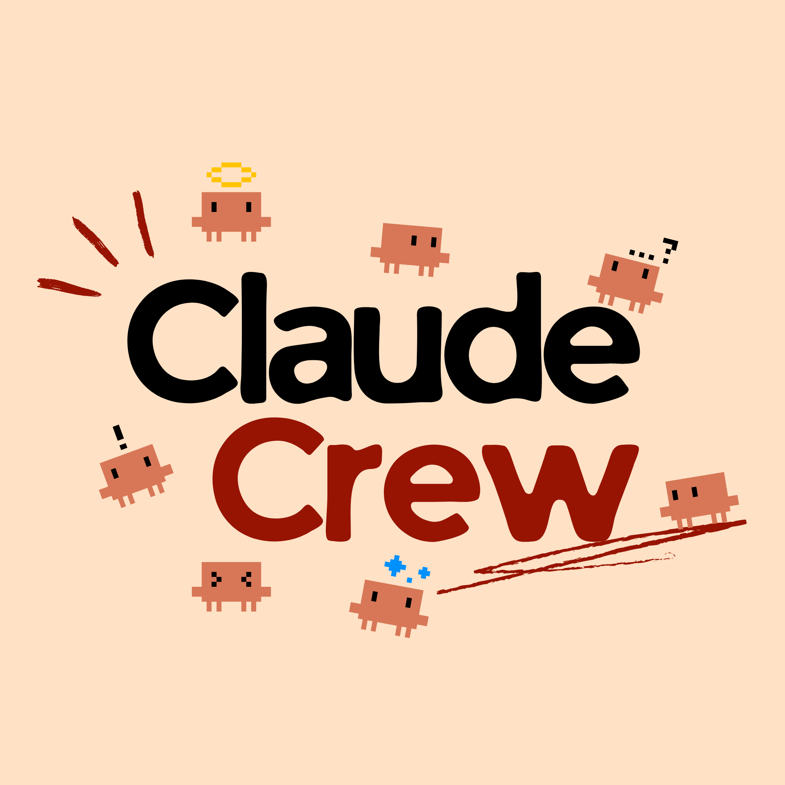
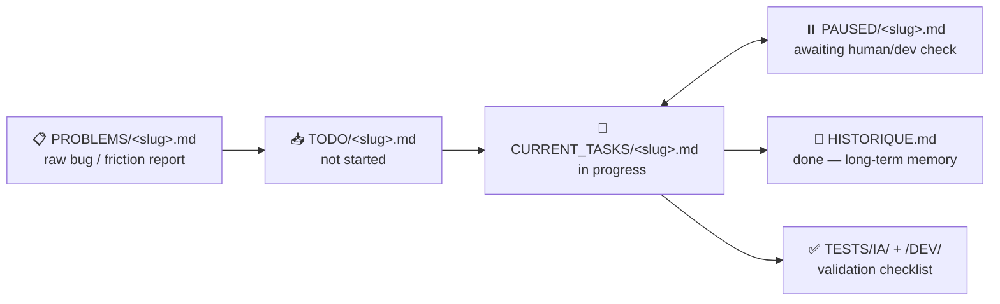

<div align="center">



# 🗂️ claude-crew

**File-based task lifecycle, multi-agent collision prevention & 10 Zero-Token UI mods for Claude Code.**

[](./LICENSE)
[](./CHANGELOG.md)
[](#-whats-in-the-box)
[](#-10-zero-token-mods-in-process-ui)
[](https://github.com/anthropics/claude-code)

**[Quick start](#-quick-start)** · **[How it works](#-how-it-works)** ·
**[Batching](#-the-actual-differentiator-batching)** ·
**[Zero-Token Mods](#-10-zero-token-mods-in-process-ui)** ·
**[Commands](#-commands-reference)** ·
**[What's in the box](#-whats-in-the-box)** · **[Is this for you?](#-not-for-you-if)**

</div>

---

> [!TIP]
> Claude Code forgets everything between sessions. Run two instances on the
> same repo and they'll happily edit the same files at the same time, with no
> warning. `claude-crew` fixes both — with plain Markdown files, two stdlib-only
> Python hooks, and **10 native Zero-Token Claude Code Mods** rendering live
> multi-session, cache, and batch telemetry directly inside the Claude Code UI.
> No server, no DB (the local web dashboard is optional).
>
> **Install in one command, working in five minutes, nothing to host.**

<br>

## 🧩 The problem

| | |
|---|---|
| 🧠 **Session amnesia** | Every new Claude Code session starts blind: what's done, what's half-done, why a decision was made — gone unless you paste it back in yourself. |
| 💥 **Multi-agent collisions** | Parallelizing Claude Code (one instance per workstream) is the obvious way to go faster. It's also the fastest way to get two agents editing the same file at the same time, silently. |
| 🕶️ **Flying blind on cache, context & batches** | You don't see your prompt cache about to expire (`5 min` / `1h` TTL), your context approaching forced compaction, which subagent is running, or your batch ETA — unless you burn tokens asking Claude. |

> [!TIP]
> Recognize any of these? A ⭐ on [`claude-crew`](https://github.com/Nakken13/claude-crew) helps other people hitting the same wall find it.

<br>

## ⚙️ How it works

A task is a file. Its state *is* which folder it's in — no status field to
forget to update, `git mv` is the state transition:



A file is never in two folders at once. `git log --follow` on a task file is
its entire history.

<br>

## 🎯 The actual differentiator: batching

Plenty of scaffolds give you a prompt template and a folder layout. What
`claude-crew` adds is tracking *which files each task touches* (its "zone"),
grouping tasks that share a zone into the same batch, and **preventing** —
not just flagging — a collision when a batch's zone overlaps an **active**
batch it doesn't belong to. Two layers, not one:

- **Layer 1 — physical isolation.** Each active batch runs in its own `git
  worktree` (`../<repo>-batch-<slug>/`, sibling of the main checkout) on its
  own branch (`crew/batch-<slug>`). Two Claude Code instances on two
  different batches are never pointed at the same working tree, so a raw
  filesystem collision between them is structurally impossible, not just
  discouraged.
- **Layer 2 — a blocking gate.** A `PreToolUse` hook intercepts every
  `Edit`/`Write`/`MultiEdit` call and every mutating `Bash` command
  (`rm`/`mv`/`cp`/output redirection/`git mv`) and **rejects it (`exit 2`)
  before it runs** if the path it touches falls under a `Zone:` already
  locked by a *different* session. The lock itself is registered
  preventively at the moment a task moves `TODO → CURRENT_TASKS` — including
  when that `git mv` is run from inside a batch worktree rather than the
  main checkout — written under a mutex with an atomic file replace, so two
  sessions racing to claim the same batch can't both win.

The `PreToolUse` hook only spawns Python when it can matter: a shell pre-filter
skips it unless `crew/CLAUDE_CONTEXT/.gate_armed` exists (maintained by the lock
writer, present only while ≥ 2 sessions hold locks) or the `Bash` call is a claim
(`git mv` into `CURRENT_TASKS/`, `crew-resume:`). Solo sessions pay ~40 ms instead
of ~270 ms per `Edit`/`Write`. Set `CREW_HOOK_PROFILE=minimal` to disable the
`PreToolUse` gate entirely (`Stop`/`SessionEnd` keep syncing indexes and locks).

A `SessionStart` hook (`startup|resume|compact`) injects a read-only crew digest (≤ 2000 chars:
active/paused tasks with `n/m` checkboxes, active batches, other sessions' locks, last 3
`HISTORIQUE.md` entries) so a resume or compaction doesn't re-read `crew/` by hand. Set
`CREW_SESSION_DIGEST=off` to disable it.

A `Stop` hook still regenerates `INDEX.md`/`BATCH_LOCKS.md` and re-checks
zone overlaps every turn, but now purely as a retroactive fallback (a
`git mv` run outside a tracked `Bash` call, or the `PreToolUse` gate getting
bypassed) — it's no longer the only thing standing between two agents and
the same file.

> [!IMPORTANT]
> You catch the collision **before** you point a second Claude Code instance
> at the same code — and if you somehow don't, the write itself gets
> refused instead of silently landing.

```text
🟢 Batch A — Zone: frontend/checkout/**   [worktree ../repo-batch-a/, branch crew/batch-a]
🟢 Batch B — Zone: backend/payments/**    [worktree ../repo-batch-b/, branch crew/batch-b]
🔴 Batch C — Zone: frontend/checkout/**   <-- overlaps Batch A, write blocked (exit 2) before it happens
```

This is the part that matters once you're running more than one agent — the
folder lifecycle alone is a nice-to-have, the worktree isolation + blocking
gate is what actually keeps parallel Claude Code instances from stepping on
each other's files.

<br>

## 🎛️ 10 Zero-Token Mods (in-process UI)

Requires a Claude Code build that supports hook `modules` (validated on
`v2.1.314`; check with `claude plugin validate .`). `claude-crew` includes **10 native TypeScript Mods** loaded in-process via
`hooks/hooks.json` (`"modules": ["./register.ts"]`). They draw live status bands
above your prompt and interactive side panes — **without spending a single LLM token**.

```text
┌─ AbovePrompt (live 0-token status bands) ─────────────────────────────────────────────┐
│ 🟢 2 Sessions en ligne | ⚡ 2 Current Tasks | 📋 3 Todo                                │
│ Task : [████░░] 4/6 (66%)  │  Batch : [██████░░] 3/4 tasks (75%)  │  ⏱️ Fin estimée : ~8 min (~45k tokens restants) │
│ 🎭 Agent Flow (1 actif / 2 total)                                                     │
│   ├── ✅ architect [Read, Glob, Grep] · 8s                                            │
│   └── 🔄 manager [Read, Glob, Grep, Write, Edit] · 12s                                │
│ ☀️ Clear [██░░░░░░] 42k/200k (21%)                                                    │
│ 🔥 Cache (5 min) 04:18 | cache_read: 140k · cache_creation: 8k (hit 94%)              │
└───────────────────────────────────────────────────────────────────────────────────────┘
> _
```

If another session holds a lock on a file or batch zone you try to edit, or your
prompt cache drops below `60s`, an immediate visual alert appears above the prompt:

```text
🚨 COLLISION ZONE : `backend/payments/stripe.ts` (Edit) tombe sous la Zone `backend/payments/` verrouillée par @9f5944ac (Batch B) !
⚠️ CACHE EXPIRE <60s (5 min) 00:42 | cache_read: 140k · cache_creation: 8k (hit 94%)
```

### Golden Rules (architectural invariants)

1. **0 Extra Tokens:** Strict ban on `$.model.complete`, `$.model.fork`, `$.prompt.submit`, `prompt.compose` text injection, and LLM tool registration. Everything relies exclusively on local session telemetry, `crew/` Markdown/JSON files, and `$.ui` rendering.
2. **Zero External Dependencies:** Pure native TypeScript using Claude Code's sandboxed `$` API (`$.fs`, `$.ui`, `$.command`, `$.env`). No `node_modules`, no bundler, no build step.
3. **Modular Entrypoint:** `hooks/register.ts` multiplexes lifecycle events across 10 focused modules in `hooks/mods/`.

### Step-by-step inventory of the 10 Mods

#### 👁️ Visibility & Context (Mods 1–5)

| # | Mod (`hooks/mods/`) | UI Surface | What it does (100% local) |
|---|---|---|---|
| **1** | `prompt-cache-control.ts` | `AbovePrompt` + Toast | Tracks prompt cache TTL (`5 min` default or `1h` via `ephemeral_1h_input_tokens` / `CLAUDE_CACHE_TTL=1h`), live `MM:SS` countdown, `cache_read_input_tokens` / `cache_creation_input_tokens` counters, hit-rate %, and `< 60s` expiry warning. |
| **2** | `token-weather.ts` | `AbovePrompt` + Toast | Compact 1-line context window gauge: `☀️ Clear` (`<50%`) → `⛅ Cloudy` (`50–74%`) → `⛈️ Storm` (`75–89%`, aligned with `claude-crew`'s 150k rule) → `🚨 Compact soon` (`≥90%`). |
| **3** | `turn-inspector.ts` | `Pane` (`/crew-turns`) | Side panel logging every turn: `in`/`out` tokens, cache `R`/`W`, deduplicated tool calls (`Read×3, Edit`), turn duration, and context bar. |
| **4** | `stack-viewer.ts` | `Pane` (`/crew-stack`) | Hierarchical tree of everything active in the session (`CLAUDE.md`, `AGENTS.md`, `.claude/rules/*`, MCP servers, skills, agent personas, 0-token mods & shell hooks) annotated with **source** and **priority** (`P1` local override → `P3` plugin/docs). |
| **5** | `agent-flow.ts` | `Pane` (`/crew-agents`) + `AbovePrompt` | Intercepts `tool.call` subagent launches (`Agent`, `Task`, and `claude-crew` personas `ceo`, `manager`, `architect`, `designer`, `legal`, `comms`, `social`, `seo`) and renders a live execution tree (`🔄` / `✅` / `🚫` / `❌`, tools, elapsed time). |

#### ⚡ Tasks, Batches & Multi-Session (Mods 6–10)

| # | Mod (`hooks/mods/`) | UI Surface | What it does (100% local) |
|---|---|---|---|
| **6** | `crew-radar.ts` | `AbovePrompt` | Global status bar: `🟢 X Sessions en ligne \| ⚡ Y Current Tasks \| 📋 Z Todo` (plus `⏸️ Paused`). Maintains `.claude/crew-sessions.lock` on `session.start`/`session.end` and merges worktree-aware `crew_lock.json` sessions. |
| **7** | `batch-progress.ts` | `AbovePrompt` | Parses active task checkboxes (`- [x]` vs `- [s]`/`- [ ]`) → `Task : [████░░] 4/6 (66%)` (updates mid-turn on `Write`/`Edit`) and `crew/CLAUDE_BATCH.md` → `Batch : [██████░░] 3/4 tasks (75%)`. |
| **8** | `batch-dependency-graph.ts` | `Pane` (`/crew-board`) | Kanban & dependency board (`Todo \| In Progress \| Done \| Blocked`) for the active batch. Links tasks to `@sess:<id>` locks and flags `PAUSED/` tasks, sequential prerequisites, and cross-session `Zone:` blocks. |
| **9** | `file-lock-monitor.ts` | `AbovePrompt` + Toast | Monitors `tool.call` (`Edit`, `Write`, `MultiEdit`). Fires an instant red UI banner & toast if the target path is actively edited in `.claude/crew-sessions.lock` or falls inside a batch `Zone:` locked in `crew_lock.json` by another session. |
| **10** | `batch-eta-cost.ts` | `AbovePrompt` | Tracks completed task duration & token velocity per batch in `.claude/crew-batch-metrics.json` to display a live estimate: `⏱️ Fin estimée : ~8 min (~45k tokens restants)`. |

### Architecture under `hooks/`

```text
hooks/
├── hooks.json                        # Declares "modules": ["./register.ts"] + Python PreToolUse/Stop/Session* hooks
├── register.ts                       # Single Mod entrypoint, onion-middleware bus & unified /crew-ui command
├── mods.test.ts                      # Automated test suite executed via `claude plugin test .`
└── mods/
    ├── shared.ts                     # Sandbox-safe types, Markdown/batch/lock parsers, worktree & zone matchers
    ├── prompt-cache-control.ts       # Mod 1 — Cache TTL countdown & read/write counters
    ├── token-weather.ts              # Mod 2 — 1-line context window weather gauge
    ├── turn-inspector.ts             # Mod 3 — /crew-turns per-turn telemetry side pane
    ├── stack-viewer.ts               # Mod 4 — /crew-stack loaded context/MCP/skills/agents/mods tree
    ├── agent-flow.ts                 # Mod 5 — /crew-agents live subagent execution tree
    ├── crew-radar.ts                 # Mod 6 — Global online sessions & task counters (.claude/crew-sessions.lock)
    ├── batch-progress.ts             # Mod 7 — Live Task [████░░] & Batch [██████░░] progress bars
    ├── batch-dependency-graph.ts     # Mod 8 — /crew-board Kanban (Todo | In Progress | Done | Blocked)
    ├── file-lock-monitor.ts          # Mod 9 — Multi-session Edit/Write anti-collision UI alert
    └── batch-eta-cost.ts             # Mod 10 — Real-time batch ETA & remaining tokens estimator
```

<br>

## ⌨️ Commands reference

### Instant local UI commands (0 LLM tokens — handled in-process by Mods)

```text
/crew-ui                        # Overview of all 10 Zero-Token Mods & their current ON/OFF state
/crew-ui all [on|off]           # Open or close all 4 interactive panes & status bands at once
/crew-ui radar [on|off]         # Toggle global sessions / tasks counter band (crew-radar)
/crew-ui progress [on|off]      # Toggle Task, Batch & ETA progress band (batch-progress + batch-eta-cost)
/crew-ui board   (or /crew-board)   # Toggle Kanban & Dependencies pane (Todo | In Progress | Done | Blocked)
/crew-ui turns   (or /crew-turns)   # Toggle Turn Inspector side pane
/crew-ui stack   (or /crew-stack)   # Toggle Session Stack Viewer tree pane
/crew-ui agents  (or /crew-agents)  # Toggle live Subagent Flow execution tree pane
/crew-ui cache [on|off]       # Toggle prompt cache TTL band (prompt-cache-control)
/crew-ui weather [on|off]     # Toggle token weather gauge band (token-weather)
```

### Try it locally

Mods load with the plugin — nothing to enable. From a clone:

```bash
claude --plugin-dir /path/to/claude-crew     # one-off session, no install
# or
/plugin marketplace add /path/to/claude-crew
/plugin install claude-crew@claude-crew
```

Then run `/crew-ui` in a session: it lists every band and pane with its
ON/OFF state. Already installed from GitHub? Run `/plugin update claude-crew`
once the mods are published.

**Bands don't show up?** Run `claude plugin validate .` — the output must
include a line `hooks/hooks.json names a hooks module`. If it doesn't, your
Claude Code build predates hook `modules`; update it.

### Workflow & lifecycle skills (`/crew-*`)

| Command | Role |
|---|---|
| `/crew-init` | Bootstrap the `crew/` scaffold & project docs (`CLAUDE.md`, `AGENTS.md`, `PRODUCT.md`, `SECURITY.md`, `CONTRIBUTING.md`) and verify zero `<placeholder>` remains |
| `/crew-new-task` | Create a task (`crew/TODO/` or `crew/CURRENT_TASKS/`) with concrete `- [ ]` actions and categorize its `Zone:` in `crew/CLAUDE_BATCH.md` |
| `/crew-start` | Deterministically pick & start the next collision-free task (`crew_hook.py next-task`), isolating the batch in its own `git worktree` |
| `/crew-close-task` | Close a completed task: code review / simplify check, append to `HISTORIQUE.md`, generate `crew/TESTS/{IA,DEV}/` checklists, local `crew/` git commit |
| `/crew-status` | Read-only health report: active batches, zone overlaps, locks, orphaned tasks or worktrees |
| `/crew-count` | Count how many batches can be launched in parallel right now + ready terminal titles |
| `/crew-dashboard` | Launch the optional local read/write web dashboard (`http://127.0.0.1:8943`) |
| `/crew-update` | Pull upstream engine-file updates into an already-bootstrapped project without touching `crew/` task data |
| `/crew-version` | Print the installed `claude-crew` version |

### Optional environment variables

| Variable | Values | Effect |
|---|---|---|
| `CLAUDE_CACHE_TTL` | `5m` (default) \| `1h` | Forces the prompt cache countdown window in `prompt-cache-control` when not auto-detected from `ephemeral_1h_input_tokens` |
| `CREW_HOOK_PROFILE` | `minimal` | Skips the `PreToolUse` Python subprocess gate (`Stop` and `SessionEnd` keep syncing indexes & locks) |
| `CREW_SESSION_DIGEST` | `off` | Disables the read-only `SessionStart` crew digest injection |
| `CREW_DASHBOARD_DIR` | `<path>` | Overrides where `crew/dashboard.bat` locates `scripts/dashboard/server.py` |

<br>

## 📦 What's in the box

| Piece | What it does |
|---|---|
| 🗂️ `crew/` | The task lifecycle folders (`PROBLEMS`/`TODO`/`CURRENT_TASKS`/`PAUSED`/`TESTS`/`CLAUDE_CONTEXT`/`ICEBOX`) |
| 🌳 Per-batch `git worktree` | Physical isolation — each active batch gets its own checkout (`../<repo>-batch-<slug>/`) and branch (`crew/batch-<slug>`), so parallel Claude Code instances never share a working tree |
| 🎛️ `hooks/register.ts` + `hooks/mods/*` | **10 Zero-Token TypeScript Mods** — live cache TTL, token weather, turn inspector, stack viewer, subagent tree, multi-session radar, task/batch progress bars, Kanban board, file collision monitor, and batch ETA |
| ⚡ `/crew-ui` `/crew-board` `/crew-turns` `/crew-stack` `/crew-agents` | Instant local UI commands (0 LLM tokens) to toggle interactive panes and status bands |
| 🪝 `crew_hook.py` | Two hooks in one file: `PreToolUse` blocks (`exit 2`) any `Edit`/`Write`/`MultiEdit`/mutating `Bash` into a zone locked by another session, and registers that lock preventively on `git mv`; `Stop` regenerates `INDEX.md`/`BATCH_LOCKS.md` and re-checks overlaps as a fallback |
| 🪝 `spec_to_task_hook.py` | Runs asynchronously on file writes — keeps specs and tasks in sync |
| ⚡ `/crew-init` `/crew-new-task` `/crew-start` `/crew-close-task` `/crew-status` `/crew-count` `/crew-update` `/crew-version` | Out-of-the-box skills driving the full task & batch lifecycle deterministically |
| 🎭 `agents/` (`ceo`, `manager`, `comms`, `architect`, `designer`, `legal`, `social`, `seo`) | Specialized subagent personas routed by decision type — business/priority calls, task breakdown, user-facing copy, structural tech choices, UX/retention specs, legal exposure, organic social distribution, and search/store/AI-answer discoverability |
| 📖 `CLAUDE.md` / `AGENTS.md` | Skill routing + context-efficiency rules (no reading >100-line files whole, 150k session reset budget) wired into Claude Code from day one |

Everything is plain markdown + JSON state + native zero-dependency TypeScript mods —
readable, greppable, diffable in a normal PR review. No hosted board, no account, nothing to sync.

<br>

## 🚀 Quick start

Pick one — all three end up in the same place: `/crew-init` running against
your project.

### 🔌 Option A — Install via marketplace (recommended)

```text
/plugin marketplace add Nakken13/claude-crew
/plugin install claude-crew@claude-crew
/crew-init
```

No cloning, no manual file copying — skills, agents, Python hooks, and all 10
Zero-Token Mods run straight from the installed plugin.

### 🤖 Option B — Ask Claude to install it

Paste this into Claude Code, in the project you want to set up:

```text
Install the claude-crew plugin (marketplace add Nakken13/claude-crew, then
install claude-crew@claude-crew), then run /crew-init here.
```

Claude runs the marketplace add + install for you, then bootstraps the
project the same way as Option A.

### 📋 Option C — Manual clone (no plugin system)

```bash
git clone https://github.com/Nakken13/claude-crew.git
cp -r claude-crew/{CLAUDE.md,AGENTS.md,PRODUCT.md,CONTRIBUTING.md,SECURITY.md,crew,.claude} your-project/
```

Open `your-project` in Claude Code and run `/crew-init`. Use this if you
don't want a marketplace dependency — skills, agents, and Python hooks get
copied straight into the project (note: the 10 in-process TypeScript Mods in
`hooks/` require loading `claude-crew` as a Claude Code plugin via Option A/B).

<br>

Whichever option you pick, `/crew-init` detects your stack, resolves every
`<placeholder>` with the real repo info, and fails loud
(`check_placeholders.py`) until nothing is left unfilled. Full step-by-step
in [`CLAUDE.md`](./CLAUDE.md).

<br>

## 📊 Optional: local web dashboard

A read/write web UI over your `crew/` folders (tasks, batches, tests). Local
only (`127.0.0.1`), optional — the hooks and terminal mods work fine without it.

**From Claude Code:** run `/crew-dashboard`.

**Standalone (Windows, no Claude session):** double-click `crew/dashboard.bat`,
or from the repo root:

```bat
crew\dashboard.bat
```

`crew/dashboard.bat` is copied into every project by `/crew-init` (and kept
current by `/crew-update`). It finds the server in this order: `%CREW_DASHBOARD_DIR%`
(manual override), `scripts/dashboard/` in the repo (claude-crew itself), then the
newest installed plugin under `%USERPROFILE%\.claude\plugins\cache\claude-crew\`.
So the plugin must be installed for it to work in other projects.

First run creates an isolated venv (`.dashboard-venv/`) and installs the
dashboard requirements; later runs reuse it. Needs Python 3 on the `PATH`
(`py` or `python`).

Then open the URL printed in the terminal — default `http://127.0.0.1:8943`;
if that port is taken, a free one is picked and printed instead. `Ctrl+C` in
the terminal stops the server.

<br>

## 🔄 Updating an existing project

Already bootstrapped? `/crew-update` pulls in engine-file changes (fixes,
new rules, new skills) without ever touching your `crew/` task data.

- **Plugin install (Option A/B)** — skills, agents, hooks, and Zero-Token Mods
  already run from `${CLAUDE_PLUGIN_ROOT}`, so `/plugin update claude-crew` covers those;
  `/crew-update` only checks `CLAUDE.md`/`AGENTS.md`/`PRODUCT.md`/
  `CONTRIBUTING.md`/`SECURITY.md`/`check_placeholders.py`/`crew/dashboard.bat`.
- **Manual clone (Option C)** — `/crew-update` also checks `crew_hook.py`,
  `spec_to_task_hook.py`, and the local `.claude/skills/crew-*`/
  `.claude/agents/*` copies.

It never touches `crew/TODO/`, `crew/CURRENT_TASKS/`, `crew/PAUSED/`, `crew/PROBLEMS/`,
`crew/ICEBOX/`, `crew/TESTS/`, or `crew/CLAUDE_CONTEXT/HISTORIQUE.md`, and it
never silently overwrites a file you've personalized. Each engine file gets
one of four statuses before anything is written:

- `up_to_date` — nothing to do.
- `new` — added upstream, missing locally → created.
- `apply` — unchanged locally since the last update → safe to refresh.
- `conflict` — you've edited it since → shown as a diff, never overwritten
  without you saying so.

<br>

## 🎓 Tutorial: update claude-crew

**Plugin install (Option A/B)**

1. Update the plugin itself (skills, agents, hooks, Zero-Token Mods):
   ```text
   /plugin update claude-crew
   ```
2. Restart Claude Code so the new version (`v0.6.0`) and `hooks/register.ts` are loaded.
3. In each bootstrapped project, sync the project-level files:
   ```text
   /crew-update
   ```
4. Review the report: `new` and `apply` are written for you; for every
   `conflict`, check the diff and say whether to overwrite or keep your version.

**Manual clone (Option C)**

1. Pull the latest scaffold in your clone of claude-crew:
   ```bash
   git pull
   ```
2. In each bootstrapped project, run `/crew-update` — it also refreshes
   `crew_hook.py`, `spec_to_task_hook.py`, and the local `.claude/skills/crew-*`/
   `.claude/agents/*` copies.
3. Review the report as above.

Your `crew/` task data is never modified. See
[Updating an existing project](#-updating-an-existing-project) for what each
status means.

<br>

## 🧪 Testing & verification

If you're developing or auditing `claude-crew` locally:

```bash
# Run the 10 Zero-Token Mods test suite inside Claude Code's native mod harness
claude plugin test .

# Audit mod hooks, commands, and sandboxed $-API calls (verifies 0 LLM calls)
claude plugin validate .

# Run Python hooks, updater, and web dashboard test suites
pytest -q

# Verify plugin manifests, hooks/hooks.json, mod inventory, and script sync
python scripts/dev/verify_plugin_package.py
```

<br>

## 🙅 Not for you if

> [!NOTE]
> - You're solo, one Claude Code session, small script — this is overhead you
>   don't need yet.
> - You want a hosted task board with a UI — this is deliberately local-first,
>   files-only, no service to run.

<br>

## 🤝 Contributing

Issues and PRs welcome — see [`CONTRIBUTING.md`](./CONTRIBUTING.md). If
`claude-crew` saves you a merge conflict, a ⭐ helps other people find it.

[](https://github.com/Nakken13/claude-crew)

## 📄 License

MIT — see [`LICENSE`](./LICENSE).
